  

  <a href="README.md">English</a> · <b>Español</b>

  
  
  

Desarrollador web full stack con el **Grado Superior en Desarrollo de Aplicaciones Web (DAW)**. Construyo backends con **Java, Spring Boot y PHP**, frontends con **React y Tailwind**, y en mi tiempo libre escribo addons de World of Warcraft en **Lua**, publicados en CurseForge.

## Inventario · proyectos destacados

| Calidad | Proyecto | Qué hace | Stack |
|:--:|---|---|---|
|  | [Pirson's Addons](https://github.com/Pirson-s-Addons) | Más de 20 addons open source de WoW publicados en CurseForge | Lua |
|  | [WoW Translator](https://github.com/Pirson-s-Addons/WoW-Translator) | Traduce la jerga del chat de WoW a 44 idiomas, en todas las versiones del juego | Lua |
|  | [Dungeon Quest Atlas](https://github.com/Pirson-s-Addons/DungeonQuestAtlas) | Todas las misiones, jefes y botín de mazmorras en una sola ventana | Lua |
|  | [cabina](https://github.com/SrPirson/cabina) | Panel lateral para Claude Code: modelo, contexto, límites y coste de un vistazo | TypeScript |
|  | [webeyes](https://github.com/SrPirson/webeyes) | Plugin de Claude Code para que el agente vea y resuma vídeos | Python |
|  | [TFG SocialiCar](https://github.com/SrPirson/TFG-SocialiCar) | Proyecto de fin de grado (DAW) | PHP |
|  | [Portfolio](https://github.com/SrPirson/Portfolio) | Mi web personal, [pirsondev.vercel.app](https://pirsondev.vercel.app/) | JavaScript |

## Registro de misiones

- [x] Completar el Grado Superior en Desarrollo de Aplicaciones Web
- [x] Publicar más de 20 addons y mantenerlos al día con cada parche del juego
- [x] Crear herramientas para agentes de programación con IA
- [ ] Unirme a un equipo donde seguir construyendo productos que la gente use a diario

## Talentos · stack técnico

**Lenguajes** 

**Frameworks y librerías** 

**Bases de datos y servidores** 

**Diseño** 

  

## Forma grupo

¿Tienes un proyecto en mente o una vacante? Escríbeme por [LinkedIn](https://www.linkedin.com/in/franciscocortespirson/) o echa un vistazo a mi [portfolio](https://pirsondev.vercel.app/).
