

  <picture><source media="(prefers-color-scheme: dark)" srcset="assets/card-es.svg"/></picture>

<a href="README.md">English</a> · <b>Español</b>

  <a href="https://pirson.dev/"><picture><source media="(prefers-color-scheme: dark)" srcset="assets/button-portfolio-es-dark.svg"/></picture></a>
  <a href="https://www.linkedin.com/in/franciscocortespirson/"><picture><source media="(prefers-color-scheme: dark)" srcset="assets/button-linkedin-es-dark.svg"/></picture></a>
  <a href="https://pirson.dev/assets/CV/CV-FranciscoCortesPirson.pdf"><picture><source media="(prefers-color-scheme: dark)" srcset="assets/button-cv-es-dark.svg"/></picture></a>

Desarrollador frontend en **BNT Business Telecom**, donde construyo interfaces en React para productos SaaS de telecomunicaciones e IoT. Me importan las interfaces rápidas, accesibles y bien cuidadas, y me desenvuelvo en el backend con Java, Spring Boot y PHP cuando un proyecto necesita el stack completo.

## `<Experiencia />`

<picture><source media="(prefers-color-scheme: dark)" srcset="assets/experience-es-dark.svg"/></picture>

<b>Detalles</b>

**Desarrollador Frontend · BNT Business Telecom**
- Frontend de **vDesk** y **HELIoT**, plataforma IoT para la gestión de dispositivos y automatizaciones (KNX, LoRa), en React.
- Integración con APIs REST en Python (FastAPI) en coordinación con el equipo de backend.
- Componentes reutilizables e interfaces responsive, con Git, revisión de código y entregas continuas.

**Desarrollador Full Stack · Fundación Esplai, Talent IT**
- Programa intensivo full stack; desarrollé [CleanWorld](https://github.com/SrPirson/TerraDev_CleanWorld) de principio a fin.
- SPAs en React y TypeScript con Tailwind CSS sobre APIs REST con Spring Boot, Spring Data JPA, Spring Security y JWT.
- Diseño de bases de datos MySQL, documentación con Swagger, tests con JUnit y despliegue con Docker.

**Desarrollador Web · Internet Sin Riesgos**
- Webs y tiendas online con WordPress y WooCommerce: personalización de temas responsive con HTML, CSS y PHP.
- Optimización SEO on-page, rendimiento y usabilidad.

## `<Proyectos />`

  <a href="https://pirson.dev/"><picture><source media="(prefers-color-scheme: dark)" srcset="assets/project-portfolio-es-dark.svg"/></picture></a>
  <a href="https://github.com/SrPirson/Box-Box"><picture><source media="(prefers-color-scheme: dark)" srcset="assets/project-box-box-es-dark.svg"/></picture></a>
  <a href="https://unfollowers-ig-extension.vercel.app"><picture><source media="(prefers-color-scheme: dark)" srcset="assets/project-unfollowers-es-dark.svg"/></picture></a>
  <a href="https://github.com/SrPirson/TerraDev_CleanWorld"><picture><source media="(prefers-color-scheme: dark)" srcset="assets/project-cleanworld-es-dark.svg"/></picture></a>
  <a href="https://github.com/SrPirson/cabina"><picture><source media="(prefers-color-scheme: dark)" srcset="assets/project-cabina-es-dark.svg"/></picture></a>
  <a href="https://github.com/SrPirson/webeyes"><picture><source media="(prefers-color-scheme: dark)" srcset="assets/project-webeyes-es-dark.svg"/></picture></a>

## `<Trayectoria />`

<picture><source media="(prefers-color-scheme: dark)" srcset="assets/network-es-dark.svg"/></picture>

## `<Lighthouse />`

<picture><source media="(prefers-color-scheme: dark)" srcset="assets/lighthouse-es-dark.svg"/></picture>

Una GitHub Action audita mi portfolio cada lunes y vuelve a dibujar esta tarjeta.

## `<Stack />`

<picture><source media="(prefers-color-scheme: dark)" srcset="assets/stack-es-dark.svg"/></picture>

## `<Certificaciones />`

| Certificación | Entidad | Fecha |
|---|---|---|
| Microsoft Certified: Azure AI Fundamentals | Microsoft | dic 2025 |
| Microsoft Certified: Azure Fundamentals | Microsoft | nov 2025 |
| Bootcamp Full Stack Java, Spring Boot, React y SQL | Fundación Esplai | dic 2025 |
| Copilot: Fundamentos de IA de Microsoft | Santander Open Academy | mar 2026 |
| Tailwind CSS · Fundamentos de React | OpenWebinars | 2025 |

 

<picture><source media="(prefers-color-scheme: dark)" srcset="assets/footer-es-dark.svg"/></picture>
