

  <picture><source media="(prefers-color-scheme: dark)" srcset="assets/card-en.svg"/></picture>

<b>English</b> · <a href="README-es.md">Español</a>

  <a href="https://pirson.dev/"><picture><source media="(prefers-color-scheme: dark)" srcset="assets/button-portfolio-en-dark.svg"/></picture></a>
  <a href="https://www.linkedin.com/in/franciscocortespirson/"><picture><source media="(prefers-color-scheme: dark)" srcset="assets/button-linkedin-en-dark.svg"/></picture></a>
  <a href="https://pirson.dev/assets/CV/CV-FranciscoCortesPirson.pdf"><picture><source media="(prefers-color-scheme: dark)" srcset="assets/button-cv-en-dark.svg"/></picture></a>

Frontend developer at **BNT Business Telecom**, building React interfaces for telecom and IoT SaaS products. I care about fast, accessible and well-crafted UIs, and I'm comfortable on the backend with Java, Spring Boot and PHP when a project needs the full stack.

## `<Experience />`

<picture><source media="(prefers-color-scheme: dark)" srcset="assets/experience-en-dark.svg"/></picture>

<b>Details</b>

**Frontend Developer · BNT Business Telecom**
- Frontend of **vDesk** and **HELIoT**, an IoT platform for managing devices and automations (KNX, LoRa), built in React.
- Integration with REST APIs in Python (FastAPI), working alongside the backend team.
- Reusable components and responsive interfaces, with Git, code reviews and continuous delivery.

**Full Stack Developer · Fundación Esplai, Talent IT**
- Intensive full stack program; delivered [CleanWorld](https://github.com/SrPirson/TerraDev_CleanWorld) end to end.
- React + TypeScript SPAs with Tailwind CSS on REST APIs built with Spring Boot, Spring Data JPA, Spring Security and JWT.
- MySQL database design, Swagger docs, JUnit tests and Docker deployment.

**Web Developer · Internet Sin Riesgos**
- WordPress and WooCommerce sites and stores: responsive theme customization in HTML, CSS and PHP.
- On-page SEO, performance and usability improvements.

## `<Projects />`

  <a href="https://pirson.dev/"><picture><source media="(prefers-color-scheme: dark)" srcset="assets/project-portfolio-en-dark.svg"/></picture></a>
  <a href="https://github.com/SrPirson/Box-Box"><picture><source media="(prefers-color-scheme: dark)" srcset="assets/project-box-box-en-dark.svg"/></picture></a>
  <a href="https://unfollowers-ig-extension.vercel.app"><picture><source media="(prefers-color-scheme: dark)" srcset="assets/project-unfollowers-en-dark.svg"/></picture></a>
  <a href="https://github.com/SrPirson/TerraDev_CleanWorld"><picture><source media="(prefers-color-scheme: dark)" srcset="assets/project-cleanworld-en-dark.svg"/></picture></a>
  <a href="https://github.com/SrPirson/cabina"><picture><source media="(prefers-color-scheme: dark)" srcset="assets/project-cabina-en-dark.svg"/></picture></a>
  <a href="https://github.com/SrPirson/webeyes"><picture><source media="(prefers-color-scheme: dark)" srcset="assets/project-webeyes-en-dark.svg"/></picture></a>

## `<Journey />`

<picture><source media="(prefers-color-scheme: dark)" srcset="assets/network-en-dark.svg"/></picture>

## `<Lighthouse />`

<picture><source media="(prefers-color-scheme: dark)" srcset="assets/lighthouse-en-dark.svg"/></picture>

A GitHub Action audits my portfolio every Monday and redraws this card.

## `<Stack />`

<picture><source media="(prefers-color-scheme: dark)" srcset="assets/stack-en-dark.svg"/></picture>

## `<Certifications />`

| Certification | Issuer | Date |
|---|---|---|
| Microsoft Certified: Azure AI Fundamentals | Microsoft | Dec 2025 |
| Microsoft Certified: Azure Fundamentals | Microsoft | Nov 2025 |
| Full Stack Java, Spring Boot, React and SQL Bootcamp | Fundación Esplai | Dec 2025 |
| Copilot: Microsoft AI Fundamentals | Santander Open Academy | Mar 2026 |
| Tailwind CSS · React Fundamentals | OpenWebinars | 2025 |

 

<picture><source media="(prefers-color-scheme: dark)" srcset="assets/footer-en-dark.svg"/></picture>
