  

  <b>English</b> · <a href="README-es.md">Español</a>

  
  
  

Full stack web developer with a **Higher Technical Degree in Web Application Development (DAW)**. I build backends with **Java, Spring Boot and PHP**, frontends with **React and Tailwind**, and in my spare time I write World of Warcraft addons in **Lua**, published on CurseForge.

## Inventory · featured projects

| Rarity | Project | What it does | Stack |
|:--:|---|---|---|
|  | [Pirson's Addons](https://github.com/Pirson-s-Addons) | 20+ open-source WoW addons published on CurseForge | Lua |
|  | [WoW Translator](https://github.com/Pirson-s-Addons/WoW-Translator) | Translates WoW chat slang into 44 languages, on every game version | Lua |
|  | [Dungeon Quest Atlas](https://github.com/Pirson-s-Addons/DungeonQuestAtlas) | Every dungeon quest, boss and loot table in one journal window | Lua |
|  | [cabina](https://github.com/SrPirson/cabina) | Side pane for Claude Code: model, context, rate limits and cost at a glance | TypeScript |
|  | [webeyes](https://github.com/SrPirson/webeyes) | Claude Code plugin that lets the agent watch and summarize videos | Python |
|  | [TFG SocialiCar](https://github.com/SrPirson/TFG-SocialiCar) | Final degree project (DAW) | PHP |
|  | [Portfolio](https://github.com/SrPirson/Portfolio) | My personal site, [pirsondev.vercel.app](https://pirsondev.vercel.app/) | JavaScript |

## Quest log

- [x] Complete the Higher Technical Degree in Web Application Development
- [x] Publish 20+ addons and keep them updated with every game patch
- [x] Ship developer tools for AI coding agents
- [ ] Join a team where I can keep building products people use every day

## Talents · tech stack

**Languages** 

**Frameworks & libraries** 

**Databases & servers** 

**Design** 

  

## Party up

Have a project in mind or an open position? Message me on [LinkedIn](https://www.linkedin.com/in/franciscocortespirson/) or take a look at my [portfolio](https://pirsondev.vercel.app/).
